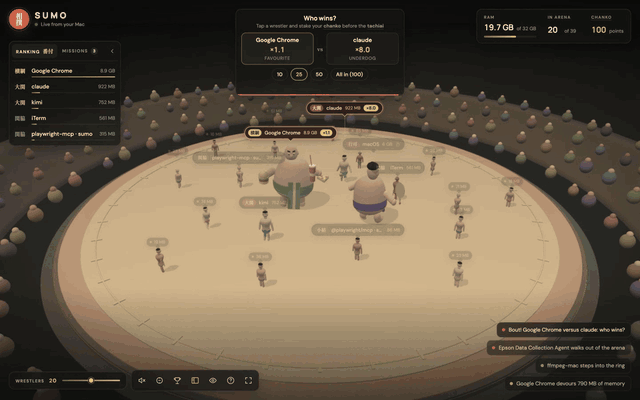

# 相撲 SUMO



Your Mac's processes and apps become sumo wrestlers in a 3D arena: the more memory they
use, the bigger they get. Processes from node, python, java and other runtimes are named
after what they are running and the project they belong to (`vite · shop`, `uvicorn · api`).
Watch them wrestle, make predictions, and push the apps that weigh too much out of the ring
(always after a confirmation; the operating system is always protected).

Also in the arena: **Who turned the fans on?** (<kbd>C</kbd>), a ten-minute CPU timeline that
names the app behind every spike, and **the basho** (<kbd>T</kbd>), a fifteen-day tournament
where each app's first bout of the day counts towards kachi-koshi and the yūshō.

## Install

macOS only (Apple Silicon and Intel).

```sh
brew install vikey89/tap/sumo
```

Or without Homebrew: the script picks the build for your Mac, checks its SHA-256 and puts
`sumo` in `~/.local/bin`, no sudo.

```sh
curl -fsSL https://raw.githubusercontent.com/vikey89/sumo/main/install.sh | sh
```

Prefer to read it first: `curl -fsSLO https://raw.githubusercontent.com/vikey89/sumo/main/install.sh`,
open `install.sh`, then `sh install.sh`. `SUMO_VERSION=0.2.0` installs a specific release,
`SUMO_INSTALL_DIR` picks another folder, and `sh install.sh --uninstall` removes it.

## Usage

```sh
sumo                        # opens the arena in a browser tab and gives you the prompt back
sumo stop                   # stops the engine
sumo status                 # tells whether the engine is running
sumo top                    # your apps' ranking, live in the terminal (c sorts by CPU, q quits)
sumo serve                  # keeps the engine in the foreground, with live RAM in the terminal
brew services start sumo    # Homebrew installs: always on in the background, even at login
```

The engine started by `sumo` runs in the background and stops by itself a couple of minutes
after you close the last arena tab. Options: `--port 4000` (or `SUMO_PORT=4000`),
`--no-open` to skip opening the browser, `--no-notify` to skip notifications when memory
runs low. Logs from the background engine go to `~/Library/Logs/sumo.log`.

The arena only listens on `127.0.0.1`: other web pages can't read your processes or quit
apps.

## Development

```sh
npm install
npm run dev         # Rust engine on :3001 and the Vite arena on :5173
npm run build:cli   # binary with the arena embedded: server/target/release/sumo
```

## Releasing

1. Bump `version` in `server/Cargo.toml`, then create and push the tag: `git tag v0.2.0 && git push --tags`.
2. The GitHub Action builds for Apple Silicon and Intel and publishes the release.
3. If the `HOMEBREW_TAP_TOKEN` secret is set (a token with write access to
   `homebrew-tap`), it also updates `Formula/sumo.rb` in the tap.

## License

[MIT](LICENSE)
